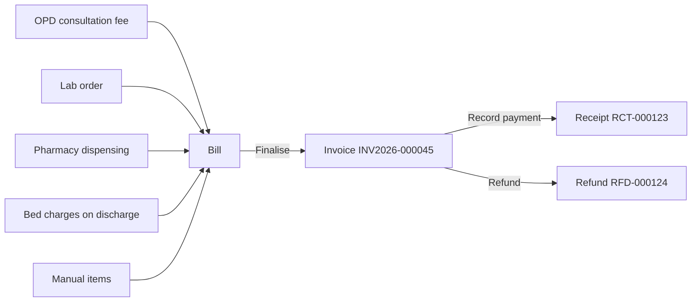

# 6. Money: billing, payments, expenses & analytics

## Where money comes **in**

Money from patients always goes through a **bill** (invoice).

| Rule | Why |
|------|-----|
| A bill can be edited only while it is a **draft** | So printed invoices never change later |
| Finalising gives a **gap-free number per hospital** (`INV<year>-000001`, `-000002`…) | Accounting and tax rules |
| Payments and refunds are **separate entries, never edited** | A full money trail for audits |
| You can't take more than the balance, or refund more than was paid | Prevents mistakes |
| A bill with payments can't be cancelled until refunded | Keeps money and bills in step |
| Amounts are calculated in **paise** (whole numbers) | No rounding errors like ₹99.99999 |

### GST on invoices

| Item | How it works |
|------|--------------|
| Hospital GSTIN | Settings → GST. When set, invoices print as **TAX INVOICE** with the GSTIN |
| HSN / SAC per line | Services (consultation, lab, bed, procedures) get the default SAC (9993 = human health services, editable in Settings); medicines carry their own HSN code (Pharmacy → medicine); manual lines can have their own code |
| CGST + SGST or IGST | Same-state sale: the tax is split half CGST, half SGST. Tick *Inter-state supply* on a draft bill for IGST |
| Buyer GSTIN | Optional, for corporate/TPA customers who need input-tax credit |

Most healthcare services are GST-exempt, so their tax rate is usually 0%; medicines and some items are taxable. Confirm rates with your accountant.

### Payments screen (Finance → Payments)

A single register of **every receipt and refund** across the hospital, newest first. Filters: date range, method (Cash, UPI, Card, Bank, Other), type (payments/refunds), and search by receipt, bill or patient. The cards on top show **Received**, **Refunded** and **Net collection** for the filters you chose — handy for the daily cash tally.

### Deposits / advances (Finance → Deposits)

Many patients pay an **advance** at admission (or before a procedure). **Take deposit** → patient, amount, method → a receipt `ADV-000001` is made.

- The money stays on the **patient's account** (left list = everyone holding a deposit; click a name for the full ledger).
- On a finalised bill, **Pay from deposit** uses it (up to the amount due and the balance available). It shows on the bill as a payment by *deposit*.
- **Refund** returns unused money (reason required, receipt `ADR-…`).
- Dashboards and reports count money **once**: when the deposit is received — not again when it is used on a bill.

### Payment links (UPI)

On a finalised bill with a balance, **Payment link** → *Create link* (copy it) or *Send on WhatsApp / by e-mail*. The patient sees only the hospital name, bill number and amount due, with a **UPI QR** and a *Pay with UPI app* button — the money goes **directly to your hospital's UPI ID** (Settings → Payments). The link works for 7 days and can be revoked; it shows *Paid* once the bill is settled. When the money arrives, record it on the bill as **UPI** with the UTR number.

### Cash closing (Finance → Cash closing)

At the end of each shift every cashier:

1. Opens **Cash closing** — it shows what *they* collected since their last closing, by method (cash, UPI, card…), with the transaction list.
2. Enters the **opening float** (cash they started with) and **counts the notes and coins** (or types the total).
3. The screen shows *Expected* vs *Counted*: **Matches**, **Short** or **Excess**. A difference needs a note.
4. **Close my cash** → closing `CC-000001`, printable slip with signature lines.

Owners, accountants and managers see **all users' closings** (permission *View every user's cash closings*).

## Where money goes **out** — Expenses (Finance → Expenses)

Record every expense:

| Field | Example |
|-------|---------|
| Date | 28-10-2026 (cannot be in the future) |
| Category | Lab reagents & consumables |
| Amount | ₹4,200 |
| Paid by | UPI |
| Paid to | Medi Supplies |
| Reference / bill no. | Supplier bill 1123 |
| Notes | Reagent kit for CBC analyser |

Each expense gets a number like `EXP-000007`. You can edit or delete an expense (both are written to the Audit log).

**Categories** — new hospitals start with: Salaries, Rent, Electricity & utilities, Lab reagents & consumables, Equipment maintenance, Medical supplies, Marketing, Miscellaneous. Click **Categories** to add more, deactivate, or delete unused ones.

## Seeing the result — Analytics (Insights → Analytics)

| Figure | How it is calculated |
|--------|----------------------|
| **Net collections** | Payments received − refunds, in the chosen period |
| **Expenses** | Sum of expenses dated in the period |
| **Profit (cash basis)** | Net collections − expenses |
| **Outstanding** | Unpaid balance of all finalised bills (all time) |
| **Lab revenue / avg order value** | Net amount of non-cancelled lab orders |
| **Avg. turnaround** | Average time from lab order to verified report |
| **Referral commission** | Referral doctor's business × their commission % |

"Cash basis" means: money is counted when it is actually received or spent — the simplest way for a clinic owner to see whether the business is making money.

All numbers come **only from recorded entries** — nothing is estimated.

## Reports (Insights → Reports)

Tables you can download as CSV (opens in Excel): registrations, appointments, admissions, **collections by day & method**, **outstanding bills**, lab, inventory. Downloaded files are protected against "formula injection" (a trick where a cell is made to run an Excel formula).

## Daily closing checklist (suggested)

1. Every cashier does **Cash closing**; the accountant checks the list for *Short / Excess*.
1. **Payments** → today's date → note *Net collection* and the split by method; match with the UPI app and card machine.
2. **Expenses** → make sure today's spending is entered.
3. **Lab orders** → filter *Payment: Unpaid / Partial* → follow up balances.
4. **Billing** → no drafts left that should have been finalised.
5. Weekly: **Analytics → 7 days**.

Next: [7. Super Admin guide →](07-super-admin-guide.md)
