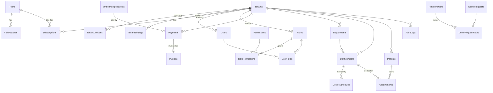

# Architecture

## Shape
A **modular monolith**: one Express API, one React SPA, one SQL Server database. Three surfaces share the SPA build:

| Surface | Production host | Dev path | Auth |
|---|---|---|---|
| Public website | `app.example.com` | `/`, `/pricing`, … | none |
| Super Admin | `admin.example.com` | `/admin/*` | `PlatformUsers`, cookies `hms_admin_*`, token `typ=platform` |
| Hospital app | `<slug>.app.example.com` | `/app/*` | `Users`, cookies `hms_*`, token `typ=tenant` |

Request path: `React → /api/v1/* → helmet/CORS/CSRF → resolveHostTenant → requireTenant (session + tenant + permissions from DB) → requirePermission → route → parameterised SQL scoped by ctx.tenantId`.

## Purchase → provisioning workflow
1. `GET /plans` — prices come from `dbo.Plans` (never hard-coded); GST computed in integer paise.
2. `POST /onboarding/checkout` — validates, hashes the owner password, creates a provider order, stores `OnboardingRequests` + `Payments(status=created)`.
3. Browser opens Razorpay Checkout (or the sandbox gateway in dev).
4. `POST /onboarding/verify` — HMAC signature verified **on the server**; and/or the signed webhook `payment.captured`.
5. `finalizePaidOrder` (one transaction, `UPDLOCK` on the payment row → idempotent): payment → paid, then `provisionTenant`: Tenant, TenantDomain, settings, sequences, 9 roles + permissions, owner user, departments, Subscription, Invoice, audit log.
6. Owner session cookies are issued; browser goes to `/app/dashboard`.

A frontend "success" redirect never activates anything.

## Tenant isolation (shared database, shared schema)
1. **Tenant comes from the server-side session**: the access JWT carries `tid` + `sid`; every request re-reads user, tenant status, session validity and permissions from SQL with `WHERE u.UserId=@uid AND u.TenantId=@tid` (`middleware/auth.js`).
2. **Subdomain can only narrow**: if the Host is `blue-care.app…` but the session belongs to `green-valley` → 403 `TENANT_MISMATCH`.
3. **No client TenantId**: request bodies are validated with strict zod schemas — an unknown `tenantId` field is a 400.
4. **Every query is scoped** `WHERE TenantId = @tid AND <Id> = @id`; a foreign record returns **404** (no existence leak).
5. **Database-level guard**: child tables use **composite foreign keys** `(TenantId, ParentId)` → `(TenantId, Id)`, so SQL Server itself rejects e.g. an appointment of hospital A pointing to a patient of hospital B (error 547).
6. **Super Admin is separate** (table, cookie, token type). The admin API exposes tenant metadata and usage counts only — never patient records — and logs tenant views.
7. Tests: `tests/unit/security.test.js` (decision logic) and `tests/integration/tenant-isolation.test.js` (HTTP + DB).

### Shared DB vs. database-per-tenant
| | Shared schema (chosen) | DB per tenant |
|---|---|---|
| Cost / ops | one DB, one migration run | N databases, N migrations |
| Isolation | logical (app + composite FKs) | physical |
| Noisy neighbours | possible; mitigate with indexes & pool limits | contained |
| Per-customer backup/restore | harder (filter by TenantId) | trivial |
| Enterprise / regulatory asks | may require more | easiest to satisfy |

Recommendation: start shared; offer a dedicated database to Enterprise customers later — the `TenantId` column makes extraction straightforward.

## Time & money
UTC `DATETIME2` everywhere; each tenant has an IANA timezone (`Asia/Kolkata` default) used to convert "today", schedules and display. Money is `DECIMAL(12,2)`; calculations in integer paise (`utils/pricing.js`). Currency per plan/tenant (INR default).

## ER diagram (core)

Relationships between tenant-owned tables (UserRoles, StaffMembers, DoctorSchedules, Appointments) are composite `(TenantId, …)` keys.

## URLs, DNS & local development
- Production: wildcard DNS `*.app.example.com` → load balancer; wildcard TLS certificate; `APP_BASE_DOMAIN=app.example.com`; `COOKIE_DOMAIN=.app.example.com`; `CORS_ORIGINS=https://app.example.com,https://admin.example.com`.
- Local: everything on `localhost:5173` (path-based). Subdomains work as `green-valley.localhost:5173` because browsers resolve `*.localhost` to 127.0.0.1 and Vite forwards the Host header to the API.
