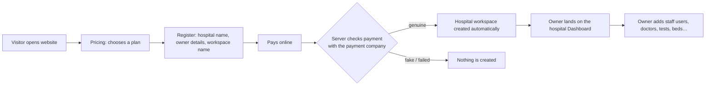
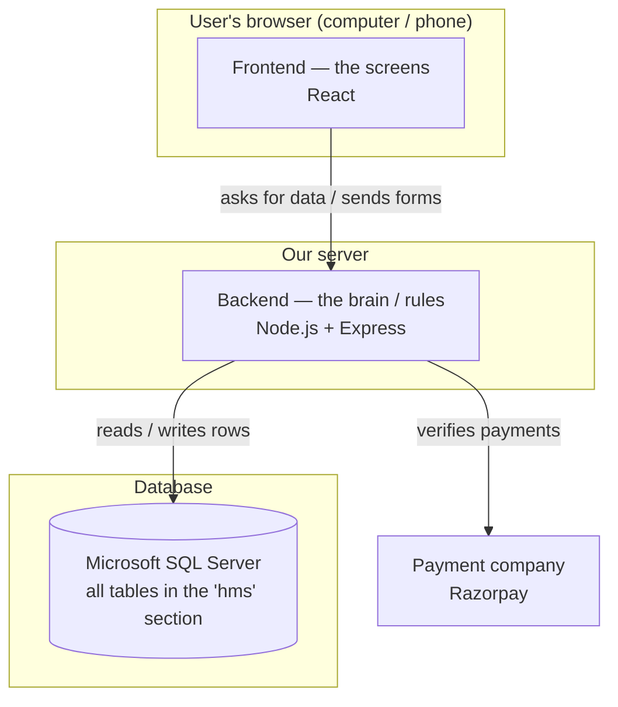
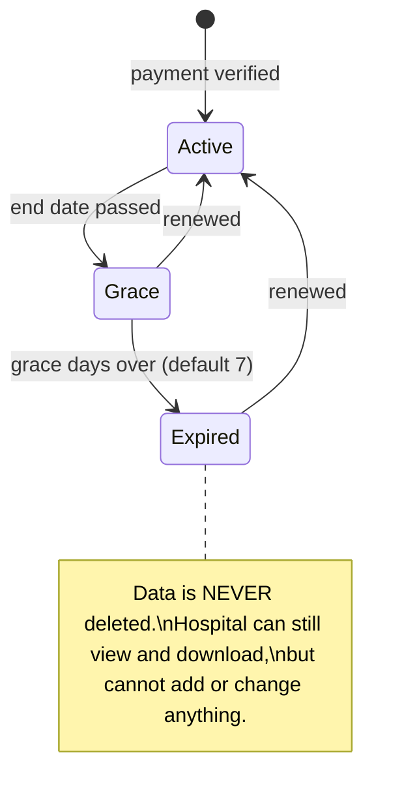

# 2. How it works — the big picture

## The customer journey (from visitor to running hospital)

Step by step:

1. **Choose a plan** on the Pricing page (monthly or yearly).
2. **Register**: enter the hospital's name, the owner's name, e-mail, password, and a **workspace name** (for example `green-valley`). The workspace name is the hospital's short ID; it appears in the web address and on the login screen.
   - **Facility type** (Clinic, Hospital, Diagnostic centre…) arranges the menu later (e.g. a diagnostic centre sees Laboratory first). If the chosen plan lacks modules that type usually needs — e.g. a diagnostic centre on Starter (no Laboratory) — the page shows a warning with a one-click *Switch to Professional*. You may still continue with the cheaper plan.
   - Mistakes are shown in plain words under each field (e.g. "This field is required.", "Enter a valid e-mail address").
3. **Pay**. The payment window is run by the payment company (Razorpay). Card/UPI details never touch our server.
4. **Verification.** Our server asks the payment company *"was this really paid?"* and checks a secret digital signature. Only if the answer is yes does it continue. A person cannot fake a payment by editing the web page.
5. **Workspace creation** happens in one go. The system creates, all together:
   - the hospital (tenant) record and its settings
   - the owner's login
   - the standard roles (Doctor, Nurse, Receptionist, Lab Technician…)
   - default departments, default lab tests and expense categories
   - the subscription (start and end date) and the first invoice

   If any one step fails, **everything is undone** — you never get a half-created hospital.
6. The owner is logged in and sees the **Dashboard**.

## How the software is built (no jargon version)

There are **three layers**:

| Layer | Plain meaning | Technology |
|-------|---------------|------------|
| **Frontend** | The screens you see and click | React, Vite, Tailwind CSS, Motion (animations) |
| **Backend** | The "brain": checks who you are, what you are allowed to do, and applies all the rules (e.g. a bed can't be given to two patients) | Node.js + Express |
| **Database** | The filing cabinet where everything is stored permanently | Microsoft SQL Server |

The screens **never talk to the database directly**. Every request goes through the backend, which checks permissions first. This is the main safety gate.

## How "one database, many hospitals" stays separate

Every row in every table (each patient, bill, test, bed…) carries a **hospital stamp** — a number called `TenantId`.

- When you log in, the server remembers **which hospital you belong to** inside a secure, tamper-proof login cookie.
- Every search the server makes automatically adds *"…and only rows stamped with **your** hospital"*.
- The hospital stamp **always comes from your login, never from the screen**. Even if someone edits the page or sends a crafted request saying "show me hospital 5", the server ignores it.
- The database itself also refuses to link a row of Hospital A to a row of Hospital B (for example, a bill of Hospital A can't point to a patient of Hospital B).

## What happens in a normal day (example)

1. **Reception** registers a new patient → patient gets a number like `GVH-000124`.
2. Reception **books an appointment** with Dr. Sharma at 11:00.
3. Patient arrives → reception clicks **Check in**.
4. **Doctor** opens OPD, writes notes and a prescription, orders a blood test, and **finalises** the consultation. The consultation fee can go on the bill automatically.
5. **Lab** collects the blood sample, enters the result, and a senior verifies it → the report is printed.
6. **Pharmacy** dispenses the medicines; stock reduces automatically, oldest-expiry batch first.
7. **Billing** finalises the bill and records the payment → a receipt number is generated.
8. At night the **owner** opens Analytics: today's collections, expenses and profit.

## Subscriptions in one picture

Next: [3. Installation & setup →](03-installation-and-setup.md)
