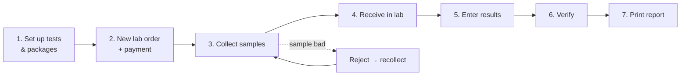

# 5. Laboratory workflow (start to finish)

This chapter follows one patient through the lab, the way a pathology lab or hospital lab actually works.

## Step 1 — One-time setup

### Tests (Laboratory → Tests)

Every new hospital starts with some common tests (Haemoglobin, Blood Sugar, HbA1c, TSH, Urine Routine…) at price ₹0. Edit them and add your own:

| Field | Example | Meaning |
|-------|---------|---------|
| Code | `CBC` | Short unique code |
| Test name | Complete Blood Count | Printed on the report |
| Department | Haematology | Groups tests on the report and in filters |
| Sample type | Blood | Tests with the **same sample type share one sample tube** |
| Unit | g/dL | Printed next to the result |
| Ref. low / Ref. high | 12 / 17 | Normal range — results outside it are **flagged** low/high |
| Reference text | "See report" | For results that are words, not numbers |
| Price | 200 | Price when ordered individually |
| Active | ✓ | Inactive tests can't be ordered but stay in old reports |

Changing a price automatically adds an entry to **price history** (you can type a reason).

### Packages (Laboratory → Packages)

A package is a bundle of tests at a special price — e.g. *Full Body Check-up*.

1. Click **New package**.
2. Enter name, department, description and status.
3. Tick the **included tests** — the screen shows the individual total as you tick.
4. Enter the **package price** — the screen shows how much the patient saves.
5. Save. A code like `PKG-000001` is assigned.

The Packages list shows: **Code · Package name · Department · # Tests · Individual total · Package price · Savings · Status**.

**Changing a package's price:** click the 💲 (Price history) button → *Add new price* → enter the new price and a **reason** (e.g. "Diwali offer"). The timeline keeps every price with date, reason and who changed it. The newest one is marked **Current**. (Price is deliberately not editable on the edit screen, so every change has a reason.)

### Referral doctors (Laboratory → Referral doctors)

Outside doctors who send patients: name, qualification, clinic, phone, e-mail and **commission %**. The list shows how many orders each has sent and the business value. Commission payable for any period is in **Analytics**.

## Step 2 — Create the order (Laboratory → Lab orders → New order)

1. **Patient** — search by name, phone or number (register them first under Patients if new).
2. **Hospital doctor** (optional) and/or **Referred by** (outside referral doctor).
3. **Priority** — Routine or Urgent (urgent orders are highlighted everywhere).
4. Tick **packages** and/or **individual tests**. If a test is already inside a ticked package it is greyed out — the system never charges a test twice.
5. **Discount** (₹) — the summary shows Total, Discount and **Net payable**.
6. **Create invoice for this order** (ticked by default) and **Payment received now** — e.g. full amount, part amount, or 0 to collect later — and the payment method.
7. **Place order**.

What happens automatically:

- An order number `LAB-000015` is created.
- A **sample** is created for each sample type (e.g. one Blood, one Urine) with numbers like `SMP-000031`.
- An **invoice** is created and finalised for the net amount, and the payment (if any) is recorded with a receipt number.
- The order appears in Lab orders with **Net, Paid, Balance** and a **payment status**:

| Payment status | Meaning |
|----------------|---------|
| Paid | Nothing due |
| Partial | Something paid, balance remaining |
| Unpaid | Invoice made, nothing paid yet |
| On patient bill | Ordered from an OPD consultation — charged on the patient's running bill |
| Not billed | No invoice was created |
| Bill cancelled | The invoice was cancelled under Billing |

To collect a balance later: open the order → **Collect payment**.

> Orders created from a doctor's **OPD consultation** go onto the patient's open bill instead of a separate invoice, so the patient pays once for everything at the counter.

## Step 3 — Collect samples (Laboratory → Samples)

- New samples are **Pending**. Click **Collect** when the sample is taken.
- Shortcut: on the order page, **Collect all samples**.
- When **all** samples of an order are collected, the order automatically moves to **Sample collected**.

## Step 4 — Receive in the lab

When the tube reaches the lab bench, click **Receive**. (Optional but useful to know where a sample is.)

**Reject** a bad sample (haemolysed, insufficient, wrong container) with a reason. The order goes back to waiting, and the sample shows **Recollect**. Rejection is only possible before results are entered.

## Step 5 — Enter results (Results & reports → Awaiting results)

Open the order → type each result → **Save results**. Numeric results are compared with the reference range and flagged **normal / low / high** automatically. When every test has a result, the order becomes **Completed**.

## Step 6 — Verify (Results & reports → Awaiting verification)

A senior person with the *Verify lab results* permission (usually the pathologist/doctor) checks and clicks **Verify**. Verified results are **locked** — nobody can change them afterwards. Unverified reports print with the words *PROVISIONAL — NOT VERIFIED*.

## Step 7 — Print the report (Results & reports → Verified reports)

Open the order → **Print report**. The printout has:

- Hospital name, address and phone (from Settings)
- Patient name, number, age/sex, referred by, order number, order and report dates
- Results grouped by **package / department**, with units, reference ranges and flags
- *Verified by* signature line, and *End of report*

Use the browser's *Save as PDF* option in the print window to e-mail it.

## Cancelling an order

Open the order → **Cancel order** (with reason) — allowed before results are entered. If the order had its own invoice, also refund/cancel that invoice under **Billing** (the order page reminds you).

## Order statuses at a glance

| Status | Meaning |
|--------|---------|
| Ordered | Waiting for samples |
| Sample collected | All samples collected; results can be entered |
| Completed | All results entered; waiting for verification |
| Verified | Final, locked, ready to hand over |
| Cancelled | Not going ahead |

Next: [6. Money: billing, payments, expenses & analytics →](06-money-billing-expenses.md)
