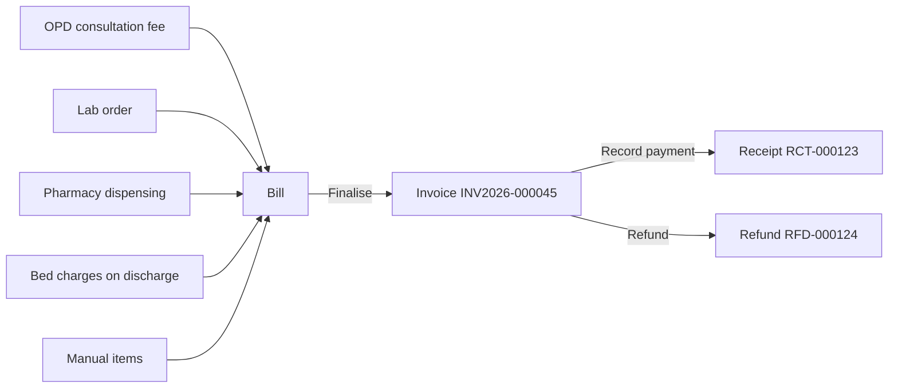

# 6. Money: billing, payments, expenses & analytics

## Where money comes **in**

Money from patients always goes through a **bill** (invoice).

| Rule | Why |
|------|-----|
| A bill can be edited only while it is a **draft** | So printed invoices never change later |
| Finalising gives a **gap-free number per hospital** (`INV<year>-000001`, `-000002`…) | Accounting and tax rules |
| Payments and refunds are **separate entries, never edited** | A full money trail for audits |
| You can't take more than the balance, or refund more than was paid | Prevents mistakes |
| A bill with payments can't be cancelled until refunded | Keeps money and bills in step |
| Amounts are calculated in **paise** (whole numbers) | No rounding errors like ₹99.99999 |

### Payments screen (Finance → Payments)

A single register of **every receipt and refund** across the hospital, newest first. Filters: date range, method (Cash, UPI, Card, Bank, Other), type (payments/refunds), and search by receipt, bill or patient. The cards on top show **Received**, **Refunded** and **Net collection** for the filters you chose — handy for the daily cash tally.

## Where money goes **out** — Expenses (Finance → Expenses)

Record every expense:

| Field | Example |
|-------|---------|
| Date | 28-10-2026 (cannot be in the future) |
| Category | Lab reagents & consumables |
| Amount | ₹4,200 |
| Paid by | UPI |
| Paid to | Medi Supplies |
| Reference / bill no. | Supplier bill 1123 |
| Notes | Reagent kit for CBC analyser |

Each expense gets a number like `EXP-000007`. You can edit or delete an expense (both are written to the Audit log).

**Categories** — new hospitals start with: Salaries, Rent, Electricity & utilities, Lab reagents & consumables, Equipment maintenance, Medical supplies, Marketing, Miscellaneous. Click **Categories** to add more, deactivate, or delete unused ones.

## Seeing the result — Analytics (Insights → Analytics)

| Figure | How it is calculated |
|--------|----------------------|
| **Net collections** | Payments received − refunds, in the chosen period |
| **Expenses** | Sum of expenses dated in the period |
| **Profit (cash basis)** | Net collections − expenses |
| **Outstanding** | Unpaid balance of all finalised bills (all time) |
| **Lab revenue / avg order value** | Net amount of non-cancelled lab orders |
| **Avg. turnaround** | Average time from lab order to verified report |
| **Referral commission** | Referral doctor's business × their commission % |

"Cash basis" means: money is counted when it is actually received or spent — the simplest way for a clinic owner to see whether the business is making money.

All numbers come **only from recorded entries** — nothing is estimated.

## Reports (Insights → Reports)

Tables you can download as CSV (opens in Excel): registrations, appointments, admissions, **collections by day & method**, **outstanding bills**, lab, inventory. Downloaded files are protected against "formula injection" (a trick where a cell is made to run an Excel formula).

## Daily closing checklist (suggested)

1. **Payments** → today's date → note *Net collection* and the split by method; match with the cash drawer and UPI app.
2. **Expenses** → make sure today's spending is entered.
3. **Lab orders** → filter *Payment: Unpaid / Partial* → follow up balances.
4. **Billing** → no drafts left that should have been finalised.
5. Weekly: **Analytics → 7 days**.

Next: [7. Super Admin guide →](07-super-admin-guide.md)
